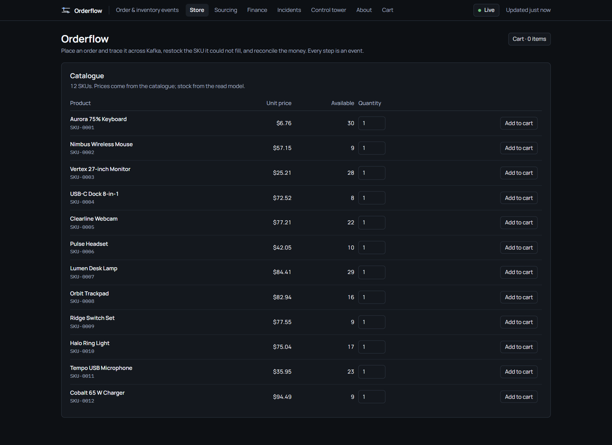
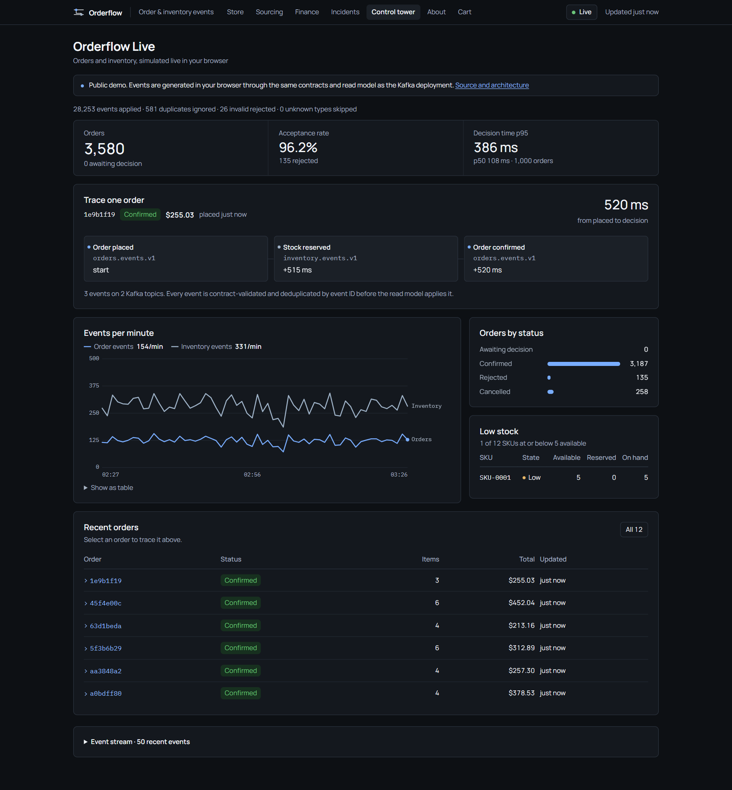

# Logos

An order platform you can operate. Five .NET services talk over Kafka; a React app is the
storefront, the sourcing desk, the ledger, the incident lab and the live control tower. Every
number on the page is folded from the same event stream, and every write becomes an event.

| Path | What |
|---|---|
| [services/](services/README.md) | Five .NET 10 services: order, inventory, procurement, finance, catalog. Outbox, inbox, three sagas |
| [services/docs/events.md](services/docs/events.md) | Event contracts: topics, payloads, saga sequences |
| [dashboard/](dashboard/README.md) | React app plus the Node API that folds Kafka into one read model and streams it |
| [deploy/](deploy/README.md) | Kubernetes (Strimzi, kind, AKS), compose, one-VM and free-tier deployments |
| [.github/jira/](.github/jira/README.md) | Pull requests linked to Jira issues and moved along the board |





## What you can do

- **Store** (`#/`). Browse a catalogue, add to cart, check out. The order service prices every
  line from the catalogue, inventory reserves all-or-nothing, and the saga decides.
- **Sourcing** (`#/sourcing`). Compare three suppliers per SKU on landed cost, lead time and
  reliability. Raise a purchase order; the goods receipt restocks inventory.
- **Finance** (`#/finance`). Captures, refunds, cost of goods, margin, the ledger, and a
  reconciliation check between two independent folds of the same events.
- **Incidents** (`#/incidents`). Publish a duplicate and a malformed message, replay the dead
  letter, and watch the consumer's own counters hold the line.
- **Control tower** (`#/ops`). Live orders, stock, throughput, and one order's path across both
  Kafka topics with the time each step took.

Writes go through the dashboard API to the service that owns them; the resulting event comes back
through Kafka like every other change. The read model is never written directly.

## Live demo

The public build on Vercel shows the platform working, with a backend when one is reachable.

- **Live mode.** With `VITE_API_URL` set, every number comes from the .NET services through Kafka,
  and checkout and purchase orders are real. [deploy/free](deploy/free/README.md) runs that
  backend for $0: an Oracle Always Free micro VM, PostgreSQL, and Aiven's free managed Kafka.
- **Fallback.** If the backend cannot be reached, the page switches to the project's own simulator
  in the browser within seconds (same contracts, same projection) and says so, so the link always
  works.

The 1 GB free tier runs orders, inventory and the catalogue; Aiven's topic cap leaves no room for
the procurement and finance topics, and the page disables them explicitly. The VM and Kubernetes
stacks run all five services.

[](https://vercel.com/new/import?s=https%3A%2F%2Fgithub.com%2Fdeveloper-az%2Flogos)

Importing the repo on Vercel needs no settings: [vercel.json](vercel.json) builds `dashboard/`
with `npm run build:demo`. Add `VITE_API_URL` (the backend's HTTPS address) and redeploy to go live.

## What it demonstrates

| Problem | How logos handles it | Where it's proven |
|---|---|---|
| Lost or phantom events when a DB write and a Kafka publish disagree | Transactional outbox, published in order by a dispatcher (`FOR UPDATE SKIP LOCKED`) | `OrderPlatform.Messaging.Tests` |
| Duplicates from at-least-once delivery | Inbox table per service, `eventId` dedupe in the read model | unit tests, integration redelivery |
| Overselling under concurrency | Optimistic concurrency on stock rows plus a check constraint | 25 concurrent orders for 10 units against real Kafka and Postgres |
| Poison messages blocking a partition | Retries with backoff, then `<topic>.dlt` with origin and error headers | messaging tests, dashboard integration test |
| Out-of-order and replayed events | Saga transitions only move forward; stock keeps the highest per-SKU version | projection tests |
| Seeing what happened to one order | Saga trace across both topics, with the time each step took | the control tower, live |
| A second saga with a compensation | Procurement quotes three suppliers, receives goods, and inventory restocks from the receipt | procurement integration test |
| Money correctness | Finance captures with integer cents and standard cost, refunds a cancellation, reconciles against order totals | finance integration test |
| A client setting its own price | The catalogue service owns prices; the order service ignores the client's and refuses the order if the catalogue is down | order pricing tests, live demo |
| Public writes being abused | The dashboard proxy limits each address to 20 writes a minute and answers `429` with `Retry-After` | rate-limit tests |

## Run the real stack

```bash
cd dashboard
docker compose up --build          # store, services, Kafka, PostgreSQL: http://localhost:8080
```

No Docker? [deploy/free](deploy/free/README.md) is $0 (1 GB VM plus managed Kafka).
[deploy/vm](deploy/vm/README.md) runs everything, Kafka included, on one 2 to 4 GB VM with HTTPS.
[deploy/railway](deploy/railway/README.md) has no server to manage (paid).
[deploy/](deploy/README.md) is Kubernetes: kind locally and AKS in production shape.
